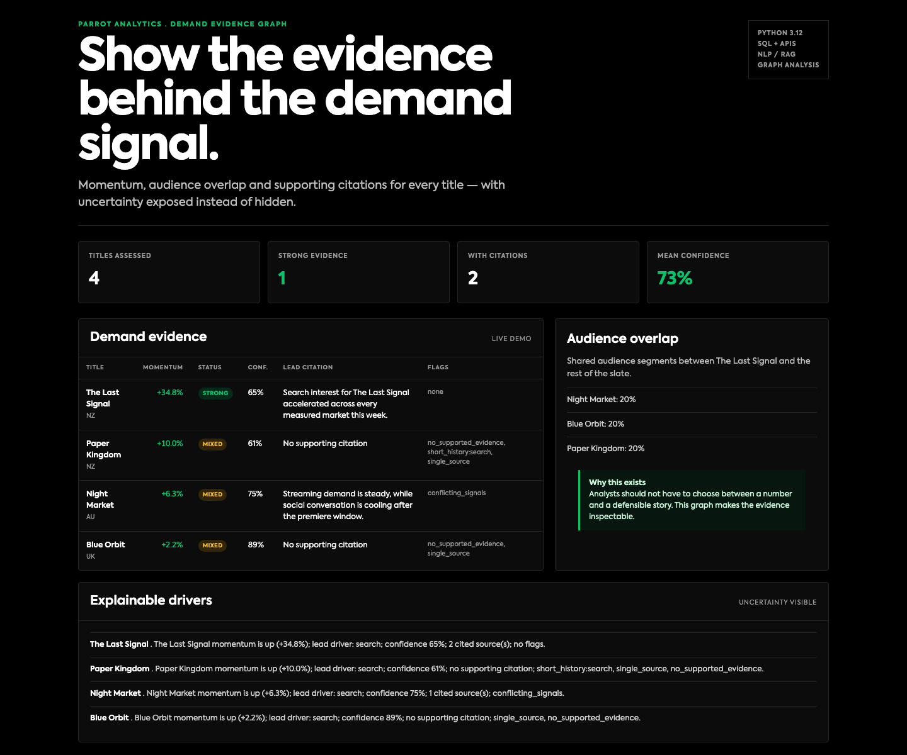

# Parrot Demand Evidence

Demand momentum, audience overlap and citation-backed explanations for entertainment
intelligence.

 Built around the gap between a demand score and a decision: an analyst
needs to show which signals moved, which evidence supports the claim, and how much
uncertainty remains.

## Stack

- Python 3.12
- FastAPI and Uvicorn
- SQL/PostgreSQL schema
- NLP-style TF-IDF evidence support
- Audience overlap graph
- pytest and GitHub Actions

## Run

```bash
python3.13 -m venv .venv
source .venv/bin/activate
pip install -e '.[dev]'
uvicorn parrot_demand.api:app --reload
# http://127.0.0.1:8000
```

API:

```bash
curl http://127.0.0.1:8000/api/assessments
curl http://127.0.0.1:8000/api/titles/the-last-signal
```

## Formula

- Momentum = (recent mean − prior baseline mean) / prior baseline mean.
- Confidence = coverage and variance of the observed signal history, bounded 0.05–0.98.
- Evidence support = cosine similarity between the claim token distribution and the
  cited quote token distribution; only matches above 0.08 are shown.
- Audience overlap = Jaccard similarity of audience segments.
- Status = strong when momentum > 8%, evidence exists and confidence >= 55%;
  mixed when there is some signal/evidence; unsupported otherwise.
- Flags surface sparse history, single-source claims, conflicting signals and missing citations.

## Verification

- 31 pytest tests.
- Dashboard uses Parrot's Axiforma font files, black `#000000`, green `#05C56B`,
  red `#F22E52`, yellow `#F7BC2D`, and 4px radius.
- SQL schema for titles, signals, evidence and assessments.

## Scope

This is a reference implementation. It does not claim live Parrot Analytics data,
DEMAND360 access or production deployment.
